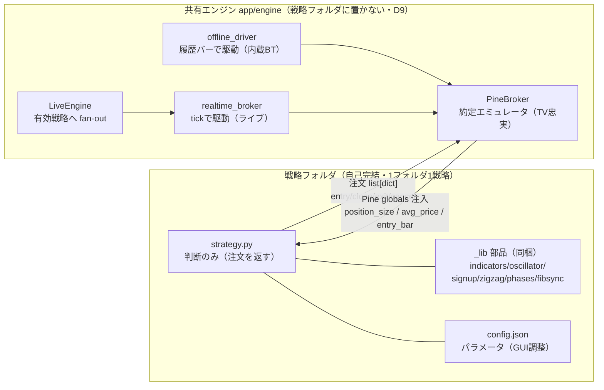
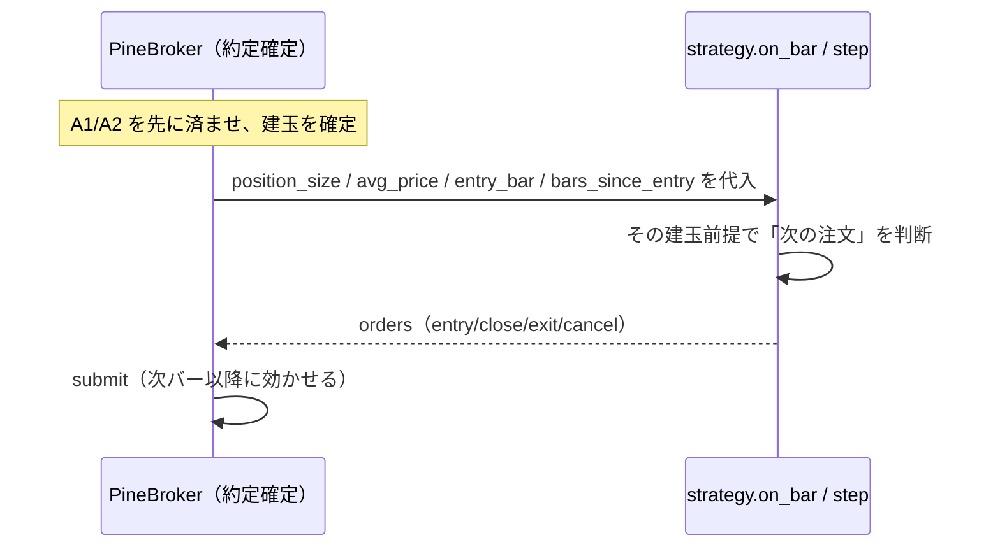
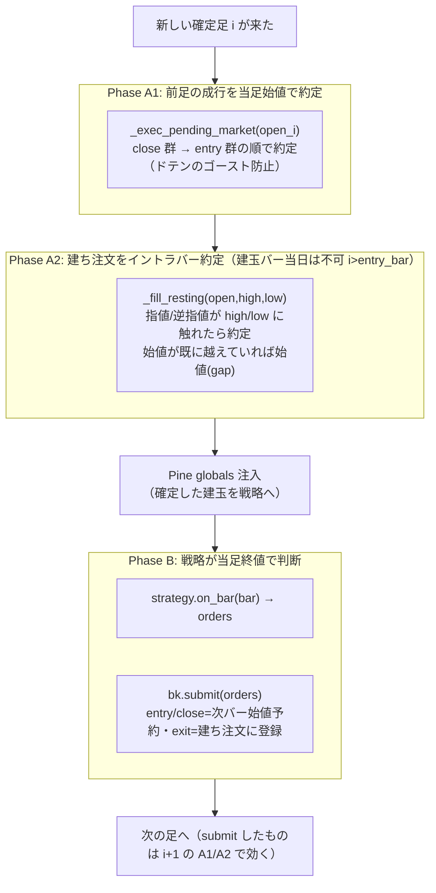
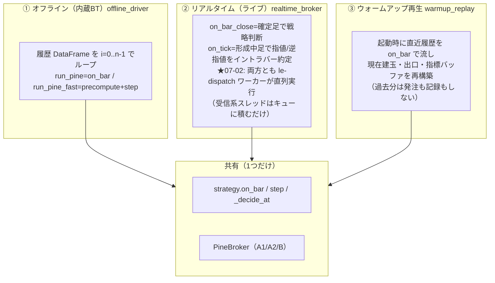
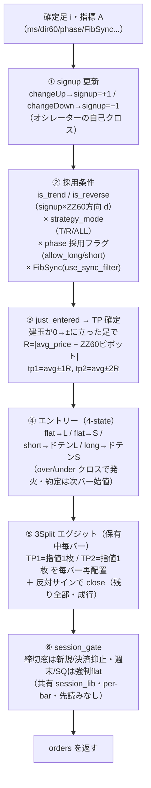
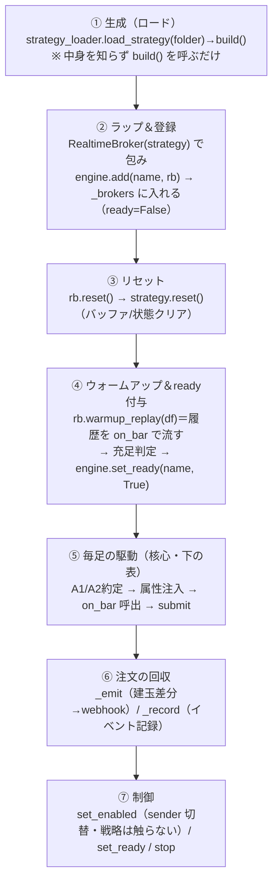
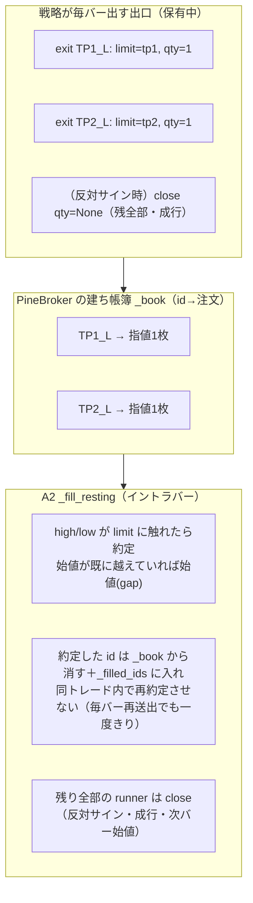
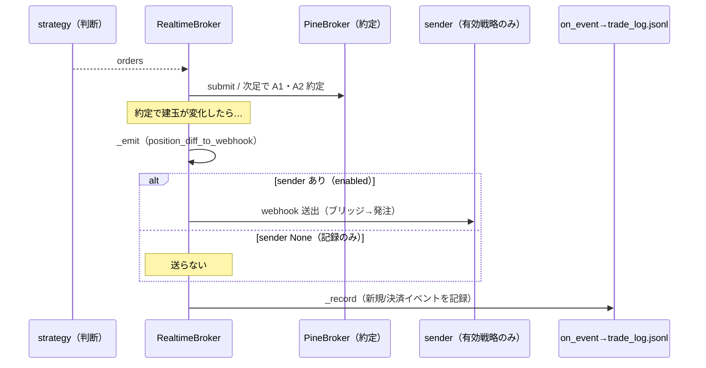

# N225LocalEngine 解説②：Python 戦略 ⇄ エンジンの関係（契約・約定・ロジック）

> 作成日: 2026-06-30　**改訂: 2026-07-02**（ライブ駆動＝ディスパッチワーカー化を追記。BT/warmup 駆動は不変）
> 対象: `N225LocalEngine`（ローカル版・全 Python 戦略実行基盤）
> 目的: **戦略（strategy.py）とエンジン（app/engine）がどう噛み合って売買が決まるか**を、
> 役割分担・契約（API）・約定モデル・戦略の判断ロジックまで一気通貫で図解する。
> 姉妹文書＝[`N225LocalEngine_ランタイムフロー解説.md`](N225LocalEngine_ランタイムフロー解説.md)（起動→ろうそく足→送出→記録）。
> 本書はその §4「売買戦略 → シグナル」を**戦略の内側まで**掘り下げたもの。
>
> 図は **Mermaid**。※ ファイル:行番号は 2026-06-30 時点のコード。

---

## 0. 結論（先に要点）

- **役割は完全分離**：
  - **戦略（strategy.py）＝「判断」だけ**。確定足を見て「注文リスト（dict）」を返す。価格をいくらで約定するかは**一切持たない**。
  - **エンジン（PineBroker）＝「約定」だけ**。戦略の注文を **TradingView 標準ブローカーと同じ規則**で埋める（成行＝次バー始値／指値・逆指値＝イントラバー）。
- **両者をつなぐ契約は2つだけ**（§2）：
  1. **戦略が返す注文プロトコル**（`entry / close / exit / cancel`）。
  2. **エンジンが戦略へ注入する Pine globals**（`position_size / position_avg_price / entry_bar / bars_since_entry`）。戦略は「今いくら・何枚持っているか」をこれで読む（＝Pine の `strategy.position_*` と同じ）。
- **二刀エンジン**：**同じ戦略コード＋同じ PineBroker** を3通りで駆動し、すべて**同一コードパス**で結果一致（§4）：
  - **オフライン**（履歴バー）＝内蔵BT（`run_pine` / `run_pine_fast`）。
  - **リアルタイム**（tick）＝ライブ（`realtime_broker`）。
  - **ウォームアップ再生**（起動時に履歴を流して現在建玉を再構築）＝`warmup_replay`。
  - → **BT ≡ ライブ ≡ warmup** が成立する（だから BT の成績がそのままライブの挙動になる）。
- **1バーは必ず3フェーズ**で処理される（§3）：**A1 前足成行を当足始値で約定 → A2 建ち注文をイントラバー約定 → B 戦略が当足終値で次の注文を出す**。
- 戦略の判断は **Pine 本体と 1:1**（§5）：**① signup 状態機械 → ② 採用条件 → ③ 建てた瞬間に TP 確定 → ④ 4-state エントリー → ⑤ 3Split エグジット**。

---

## 1. 全体像（誰が何を持つか）



**ポイント**
- 戦略は **約定エンジンを import しない**（共有 `app/engine` がホスト側に1本だけ）。戦略は `_lib`（指標）だけを自フォルダに**コピー同梱**して自己完結する（跨ぎ import ゼロ）。
- だから新戦略を足しても**エンジンは無改修**。戦略は「注文を返す関数」でありさえすればよい。
- 約定の正本は **PineBroker 一択**。オフライン driver もリアルタイム broker も、**同じ PineBroker を母体に**駆動する（＝結果が割れない）。

---

## 2. 契約（戦略 ⇄ エンジンの API）— ここだけが結合点

### 2-1. 戦略が返す注文プロトコル（[contract.py:6-16](../../app/engine/contract.py#L6)）

| 注文 | 形 | 約定タイミング |
|---|---|---|
| エントリー | `{"t":"entry","dir":+1/-1,"qty":N}` | **成行・次バー始値**（逆方向保有ならドテン） |
| 標準決済 | `{"t":"close","qty":N\|None}` | **成行・次バー始値**（None=全部） |
| 建ち注文（TP/SL） | `{"t":"exit","id":S,"qty":N\|None,"limit":P,"stop":P}` | **指値/逆指値・イントラバー**（OCO・毎バー上書き・各 ID 一度きり） |
| 取消 | `{"t":"cancel","id":S}` | 即時（建ち注文を消す） |

> 戦略は「**何をしたいか**」を注文で言うだけ。「**いつ・いくらで埋まるか**」はエンジンが決める。

### 2-2. エンジンが戦略へ注入する Pine globals（決定の直前に毎回）

戦略は Pine の `strategy.position_size` 等を読むのと同じ感覚で、エンジンが**確定した建玉**を読む。
注入は3つの driver すべてで**同じ4変数**（[realtime_broker.py:185-188](../../app/engine/realtime_broker.py#L185) / [offline_driver.py:38-41](../../app/engine/offline_driver.py#L38)）：

| 変数 | 意味 | 戦略での使い道 |
|---|---|---|
| `position_size` | 符号付き枚数（+long / −short / 0） | エントリー4-state の分岐・建てた瞬間の検出 |
| `position_avg_price` | 実約定平均値 | **TP ターゲットの基準**（avg ± R） |
| `entry_bar` | 建ったバーの絶対 index | 保有バー数の起点 |
| `bars_since_entry` | 建ってからの経過バー | 時間ベースの判断（戦略により使用） |



> この**「先に約定を確定 → 建玉を注入 → 戦略が判断」**の順序が肝。戦略は常に「**今の確定建玉**」を見て動くので、Pine の挙動（バー確定時に position が既知）と一致する。

---

## 3. 1バーの処理＝必ず3フェーズ（A1 → A2 → B）

PineBroker は1バーを**必ずこの順**で処理する。オフライン・リアルタイム・warmup の**全 driver で共通**（[offline_driver.py:31-44](../../app/engine/offline_driver.py#L31)）。



**なぜこの順序か（重要な不変条件）**
- **A1 の close→entry 順**：同バーに `close` と反対 `entry`（＝ドテン）が同居するとき、entry を先に約定すると新玉を後続 close が即閉じる「ゴーストトレード」になる。close を先に閉じてから建てるのが正（[pine_broker.py:104-119](../../app/engine/pine_broker.py#L104)）。
- **A2 は `i > entry_bar` でしか走らない**：建てた**その足の中**では TP/SL を約定させない（Pine と同じ＝建値バーは出口を許さない）。
- **B は「終値で判断・次足で約定」**：`process_orders_on_close=false` の Pine と一致。だから戦略の `entry/close` は**次バー始値**で初めて埋まる（1バー遅延が"正"）。

---

## 4. 二刀エンジン — 同じコードを3通りで駆動（BT ≡ ライブ ≡ warmup）

戦略コードも PineBroker も**1つ**。それを**入力の出どころ**だけ替えて駆動する。



| driver | 入力 | 約定の埋め方 | 用途 |
|---|---|---|---|
| **offline**（[offline_driver.py](../../app/engine/offline_driver.py)） | 履歴バー（OHLC 配列） | A2 はバーの high/low で1回 | 内蔵BT・golden 検証 |
| **realtime**（[realtime_broker.py](../../app/engine/realtime_broker.py)） | tick（形成中足） | A2 は tick で触れた瞬間（D12・TV 忠実） | ライブ運用 |
| **warmup_replay**（[realtime_broker.py:221](../../app/engine/realtime_broker.py#L221)） | 直近履歴バー | offline と同一順序 | 起動時に建玉を再構築 |

**この3者が一致する仕掛け**
- リアルタイムは「形成中足の running 高安（`_fo/_fh/_fl`）」を tick で更新し、**バー版と同じ `_fill_resting` に渡す**（[realtime_broker.py:154-156](../../app/engine/realtime_broker.py#L154)）。＝tick 駆動でも判定式はバー版と同一。
- tick を1つも受けない静かな足は、**確定足 OHLC で A1/A2 を代行**（[realtime_broker.py:168-182](../../app/engine/realtime_broker.py#L168)）。＝取りこぼしゼロ。
- warmup_replay は **offline と同じ A1→A2→B 順**で履歴を流し、最後に建玉を保持したまま live へ橋渡し（**EOD 強制決済をしない**）。だから再起動しても「今持っているはずの建玉」が復元され、最初の live 足から**差分だけ** webhook が出る（snapshot/restore 不要）。

> 📌 これが「**BT の成績がそのままライブの挙動になる**」根拠。同じ戦略・同じ約定器・同じ3フェーズを通すので、データが同じなら結果も同じ。

---

## 5. 戦略の内側ロジック（`_decide_at` ＝ Pine 本体と 1:1）

### 5-0. 戦略の3部分は「どこ」で実行されるか（指標作成／判定／エントリー・エグジット）

戦略には**入口が2つ**あり、どちらも最後は同じ `_decide_at` に集約されます：

- **live ＝ `on_bar(bar)`**（確定足ごと・バッファ再計算）
- **BT ＝ `precompute(df)` ＋ `step(A,i)`**（全系列1回計算）

| あなたの分類 | 実行場所（関数） | 中身 |
|---|---|---|
| **① 指標作成** | [`_compute_indicators(H,L,C,idx)`](../../strategies/MESA_Stochastic/strategy.py#L157) | MESA/ZZ60/phase/FibSync/ATR を `_lib` 純関数で計算。live は [`on_bar`](../../strategies/MESA_Stochastic/strategy.py#L298) から毎バー、BT は [`precompute`](../../strategies/MESA_Stochastic/strategy.py#L192) から1回 |
| **② ロジック判定** | [`_decide_at(A,i)`](../../strategies/MESA_Stochastic/strategy.py#L207) の **①〜③** | ① signup 状態更新([L220](../../strategies/MESA_Stochastic/strategy.py#L220)) ② 採用条件(trend/reverse×phase×FibSync・[L226](../../strategies/MESA_Stochastic/strategy.py#L226)) ③ 建てた瞬間の TP 確定([L244](../../strategies/MESA_Stochastic/strategy.py#L244)) |
| **③ エントリー/エグジット** | 同 `_decide_at` の **④⑤** | ④ 4-state エントリー注文生成([L255](../../strategies/MESA_Stochastic/strategy.py#L255)) ⑤ 3Split エグジット注文生成([L277](../../strategies/MESA_Stochastic/strategy.py#L277)) |

→ ③でも戦略がやるのは `{"t":"entry",...}` / `{"t":"exit",...}` という**注文 dict を返すだけ**。価格をいくらで約定するかは持ちません。

#### エンジン側（PineBroker）— エントリー/エグジットの「実際の約定」

戦略が返した注文を、TV 標準ブローカー忠実に**埋める**のがここ：

| 約定の種類 | 実行場所 |
|---|---|
| 成行（エントリー/標準決済/ドテン）＝次バー始値 | [`_exec_pending_market`](../../app/engine/pine_broker.py#L101)（Phase A1） |
| 指値/逆指値（TP1/TP2/SL）＝イントラバー | [`_fill_resting`](../../app/engine/pine_broker.py#L122)（Phase A2） |
| 注文の受付（次バー以降に効かせる） | [`submit`](../../app/engine/pine_broker.py#L169)（Phase B） |

#### 1バーで誰がいつ呼ぶか（呼び出しの連鎖）

ライブ＝ [`RealtimeBroker.on_bar_close`](../../app/engine/realtime_broker.py#L161)：

```
A1 _exec_pending_market（前足の成行を当足始値で約定）   ← エンジン（③の約定）
A2 _fill_resting（建ち注文をイントラバー約定）          ← エンジン（③の約定）
   ↓ 確定建玉を戦略へ注入（position_size 等）
strategy.on_bar(bar)  → ① 指標作成 → ② 判定 → ③ 注文生成   ← 戦略
bk.submit(orders)（次足で効かせる）                     ← エンジン
```
（指値の tick 即時約定は [`on_tick`](../../app/engine/realtime_broker.py#L132) が同じ `_fill_resting` で行う）

BT＝ [`offline_driver._run_pine`](../../app/engine/offline_driver.py#L31) のループが**まったく同じ順序**（A1→A2→注入→step/on_bar→submit）で回す。だから **BT≡ライブ**。

> ＝**①②③の"判断・注文生成"は戦略、③の"約定"はエンジン**。だから戦略はオフライン（BT）でもリアルタイム（ライブ）でも**同じコードのまま**動く（§4）。

---

`on_bar`（live・バッファ再計算）も `step`（BT・precompute 済）も、最終的に**同じ `_decide_at(A, i)`** を呼ぶ（二重実装を避ける）。MESA_Stochastic を例に、判断は**5段**（[strategy.py:207-295](../../strategies/MESA_Stochastic/strategy.py#L207)）：



### 各段の中身（MESA を例に）

- **① signup（状態機械）**：基軸オシレーター（MESA Stochastic）の**自己クロスオーバー/アンダー**で「買い待ち(+1)／売り待ち(-1)」を立てる（[strategy.py:220-224](../../strategies/MESA_Stochastic/strategy.py#L220)）。発火するまで状態を保持する＝Pine の `var` と同じ。
- **② 採用条件**：
  - `signup` と **ZZ60 の方向 `d`** の組で **順張り(is_trend)／逆張り(is_reverse)** を判定。
  - `strategy_mode`（T=順張りのみ/R=逆張りのみ/ALL）で採否。
  - **phase（6局面：peak/down_start/downtrend/bottom/up_start/uptrend）ごとの allow_long/allow_short** フラグでさらに絞る。
  - **FibSync**（`use_sync_filter`）＝ZZ60 のフィボ押し/戻りが整っているかでロング可/ショート可を最終ゲート。
- **③ just_entered → TP**：`position_size` が 0→± に立ち上がった足で **R を1回だけ確定**。`R = |position_avg_price − 約定バーの ZZ60 反対側ピボット|`、**TP1=avg±1R・TP2=avg±2R**（tp_mode=C）。avg は**エンジンが入れた実約定値**（[strategy.py:137-153,244-253](../../strategies/MESA_Stochastic/strategy.py#L137)）。
- **④ エントリー（4-state）**：建玉×signup の4組み合わせで `entry` を出す。反対玉を持っていれば `entry`（逆 dir）が**ドテン**としてエンジンで処理される（[strategy.py:255-275](../../strategies/MESA_Stochastic/strategy.py#L255)）。
- **⑤ 3Split エグジット**：保有中は**毎バー** TP1/TP2 の `exit`（指値1枚ずつ）を**再送出**し、`under/over`（反対サイン）が出たら `close`（残り全部・成行）。指値の「一度きり約定」はエンジンが `_filled_ids` で担保するので、毎バー再送出してよい（[strategy.py:277-292](../../strategies/MESA_Stochastic/strategy.py#L277)）。
- **⑥ session_gate**：合成後の最終注文に対し、共有 `session_lib` が**締切窓では新規/決済を抑止・週末/祝日/SQ 直前は強制 flat**（per-bar・先読みなし・era 対応カレンダー）。Pine 側 KengetsuLib と同一カレンダー＝Pine BT＝Python BT＝ライブが一致。

> 姉妹戦略（DT/TSI/CMF/Momentum）は **この MESA ハーネスの①基軸オシレーターを差し替えただけ**。②〜⑥の骨格（ZZ60・phase・FibSync・4-state・3Split・session）は共通。だから1つ理解すれば全戦略が読める。

---

## 6. エンジンが戦略に対して何をしているか（戦略ライフサイクル・エンジン視点）

ここまでは「戦略が何を返すか」中心だった。本節は**逆向き＝エンジン側から見て、1つの戦略に対して何を・いつ・どの順でするか**をまとめる。エンジンは戦略の中身（オシレーター/TP 等）を**一切知らない**。契約（`reset`/`on_bar` ＋ 注入する4属性）だけを通して**ブラックボックスとして**扱う。



### エンジンが戦略に「触れる」点（これが全インターフェース）

エンジンが戦略に対してするのは、**この5種類だけ**。それ以外（建玉・約定・送出・記録・カレンダー）はエンジンが自分で持つ。

| エンジンの操作 | 戦略の何に触るか | いつ | 場所 |
|---|---|---|---|
| **生成** | `build()` を呼びインスタンス化 | ロード時 | [strategy_loader.load_strategy](../../app/engine/strategy_loader.py#L57) |
| **リセット** | `strategy.reset()` | 登録/warmup 前・毎回 | [realtime_broker.py:72-73](../../app/engine/realtime_broker.py#L72) |
| **属性注入（書く）** | `position_size` / `position_avg_price` / `entry_bar` / `bars_since_entry` | **毎足・on_bar の直前** | [realtime_broker.py:185-188](../../app/engine/realtime_broker.py#L185) |
| **判断呼出** | `on_bar(bar)`（live）／ `precompute(df)`＋`step(A,i)`（BT） | 毎足 / BT | [realtime_broker.py:189](../../app/engine/realtime_broker.py#L189) |
| **戻り値の回収** | `on_bar` が返す `orders` を受け取る | 毎足 | 同上 |

> ＝**エンジンは「建玉を戦略の属性に書き込み → on_bar を呼び → 返ってきた注文を受け取る」**。これだけ。戦略の判断の中身には踏み込まない。

### 各段の詳細（エンジン視点）

- **① 生成**：`controller.load_all` が登録ごとに `load_strategy(folder)` → `build()`。**戦略名も中身も知らず**、契約を満たすインスタンスを得るだけ（[controller.py:544-557](../../app/engine/controller.py#L544)）。失敗すれば `読込失敗` で `_brokers` に入れない（＝今朝の MESA5 の件）。
- **② ラップ＆登録**：戦略を `RealtimeBroker` で包み、`engine.add(name, rb, enabled)` で `_brokers` 辞書へ。この時点で **ready=False**（[engine.py:26-29](../../app/engine/engine.py#L26)）。＝「6戦略を回す」枠がここで埋まる。
- **③ リセット**：`rb.reset()` が内部で `strategy.reset()` を呼び、戦略のバッファ・状態（signup/tp 等）を初期化（[realtime_broker.py:72-73](../../app/engine/realtime_broker.py#L72)）。
- **④ ウォームアップ＆ready 付与**：`_activate_brokers` が `rb.warmup_replay(df)` で履歴を **live と同一 on_bar** で流し、現在建玉・指標バッファを再構築 → 本数充足で `engine.set_ready(name, True)`（[controller.py:642-652](../../app/engine/controller.py#L642)）。＝前回の質問「ready を付ける所」。
- **⑤ 毎足の駆動**：`on_confirmed_bar` の fan-out（[engine.py:60-62](../../app/engine/engine.py#L60)）が **ready な戦略だけ** `rb.on_bar_close` を呼ぶ。その中でエンジンは順に：**(a) A1/A2 で約定確定 →(b) 確定建玉を戦略の属性へ注入 →(c) `strategy.on_bar` を呼ぶ →(d) 返った注文を `bk.submit`**（[realtime_broker.py:168-199](../../app/engine/realtime_broker.py#L168)）。
- **⑥ 注文の回収**：約定で建玉が変われば `_emit`（webhook 化）、`_record`（新規/決済イベント記録）。＝§8。
- **⑦ 制御**：`set_enabled` は **戦略本体を触らず**、ブローカーの `sender`（注文経路）だけ差し替える（有効＝BridgeSender / 無効＝None）（[controller.py:572-581](../../app/engine/controller.py#L572)）。だから**有効/無効でも戦略の判断は同一**＝記録は常時取れる。

> 📌 **エンジン視点のまとめ**：エンジンは戦略を「**毎足、建玉を教えて注文をもらう関数**」として扱う。約定・送出・記録・カレンダー・有効無効は**すべてエンジン側の責務**で、戦略はそれらを知らなくてよい。これが「新戦略を足してもエンジン無改修」（§1）の正体。

---

## 7. 3Split 出口とフィル規則（エンジンの約定の核心）

「3枚買って1枚ずつ返す」（[[feedback_3split_base_design]]）は、戦略の出口注文を**エンジンが OCO 帳簿で**捌くことで実現する。



**フィルの細部（TV 標準ブローカー忠実・[pine_broker.py:122-166](../../app/engine/pine_broker.py#L122)）**
- 始値が指値/逆指値を**既に越えて寄った**ら、その**始値（ギャップ）**で約定。
- バー内で**指値と逆指値が同時に届く**ときの順序＝TV 既定：**始値が高値寄り → 上昇先行（指値が先）／安値寄り → 下落先行（逆指値が先）**（[pine_broker.py:125](../../app/engine/pine_broker.py#L125)）。
- 建玉が無くなれば建ち注文は全消滅（`_flat` で `_book` クリア＝Pine と同じ）。
- `exit` の `qty=None` は「残枚数に自動追従」＝3Split の runner を別 id で持つときに有効。

---

## 8. 決定 → 約定 → 送出/記録（姉妹文書 §4 への接続）

戦略の `orders` がエンジンに入った後の「webhook 送出」「trade_log 記録」は姉妹文書に詳しい。接続点だけ再掲：



- **送出（webhook）と記録（trade_log）は別物**：`_emit` が先・`_record` が後。記録は **enabled と無関係に常時**（仮想/本番は記録時に区別）。詳細＝[`ランタイムフロー解説 §4`](N225LocalEngine_ランタイムフロー解説.md)。

---

## 付録: 主要コードポインタ早見表

| 役割 | ファイル:行 |
|---|---|
| 注文プロトコル・Bar 契約 | [contract.py](../../app/engine/contract.py) |
| 約定エミュレータ（A1/A2/B・OCO・3Split・gap順） | [pine_broker.py](../../app/engine/pine_broker.py) |
| Phase A1 成行（close→entry 順） | [pine_broker.py:101-119](../../app/engine/pine_broker.py#L101) |
| Phase A2 建ち注文イントラバー | [pine_broker.py:122-166](../../app/engine/pine_broker.py#L122) |
| オフライン driver（run_pine / run_pine_fast / summarize） | [offline_driver.py](../../app/engine/offline_driver.py) |
| リアルタイム driver（on_bar_close / on_tick） | [realtime_broker.py:131-199](../../app/engine/realtime_broker.py#L131) |
| ウォームアップ再生（建玉再構築） | [realtime_broker.py:221-256](../../app/engine/realtime_broker.py#L221) |
| Pine globals 注入（live/offline） | [realtime_broker.py:185-188](../../app/engine/realtime_broker.py#L185) / [offline_driver.py:38-41](../../app/engine/offline_driver.py#L38) |
| 戦略 fan-out（running/ready ゲート） | [engine.py:43-73](../../app/engine/engine.py#L43) |
| 戦略ローダ（自己完結フォルダ→build） | [strategy_loader.py](../../app/engine/strategy_loader.py) |
| 戦略の判断ロジック（5段・Pine 1:1） | [strategy.py:207-308](../../strategies/MESA_Stochastic/strategy.py#L207) |
| TP ターゲット（R=avg−ZZ60ピボット） | [strategy.py:137-153](../../strategies/MESA_Stochastic/strategy.py#L137) |
| 3Split エグジット | [strategy.py:277-292](../../strategies/MESA_Stochastic/strategy.py#L277) |
