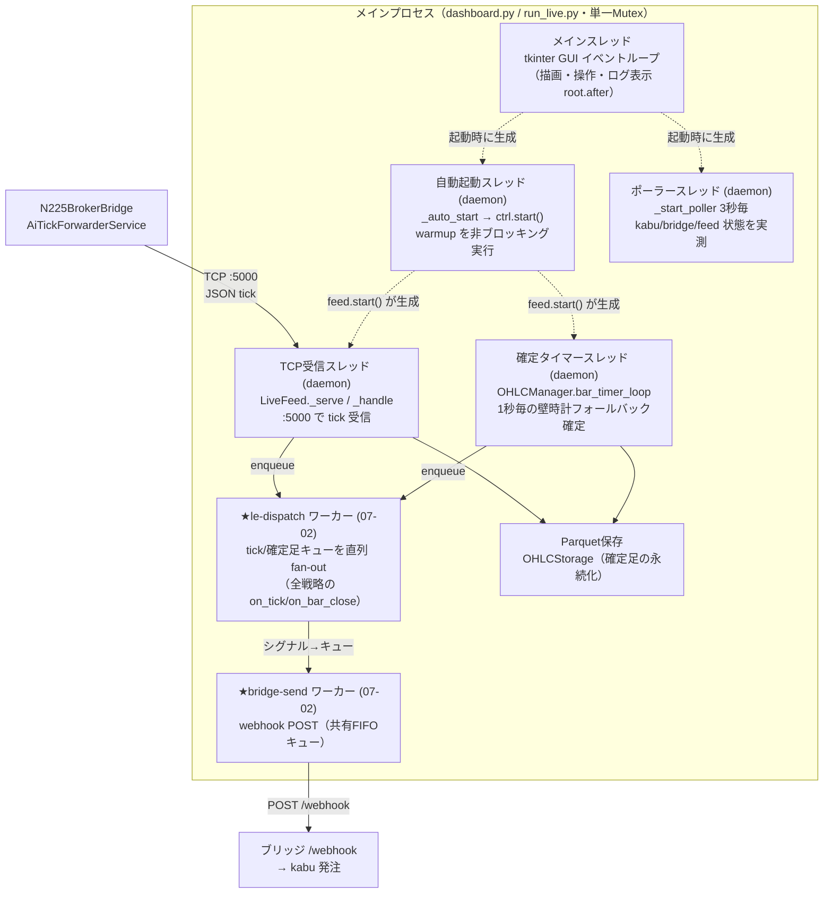
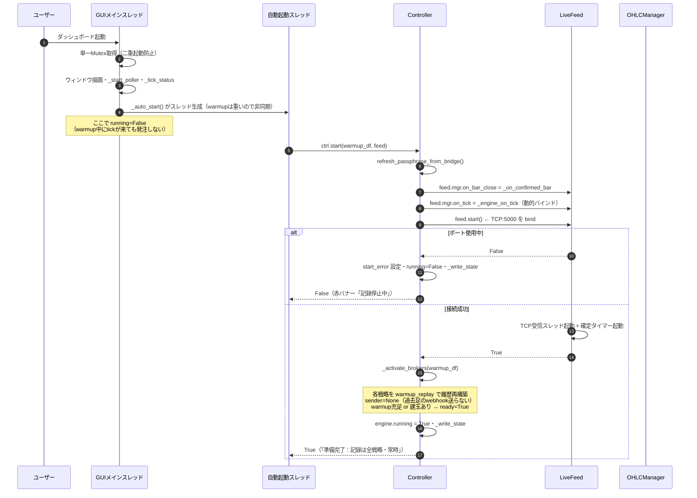
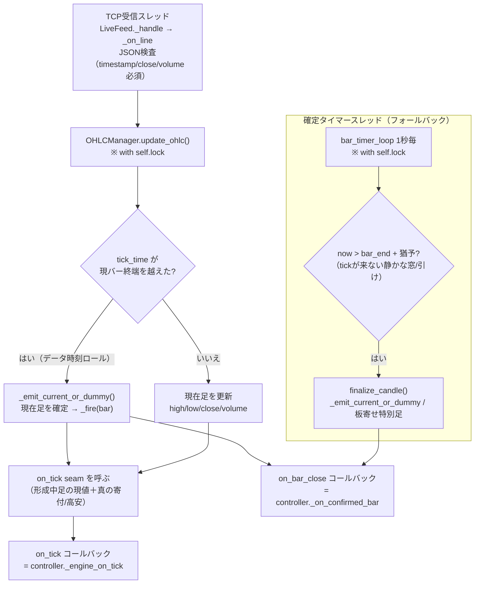
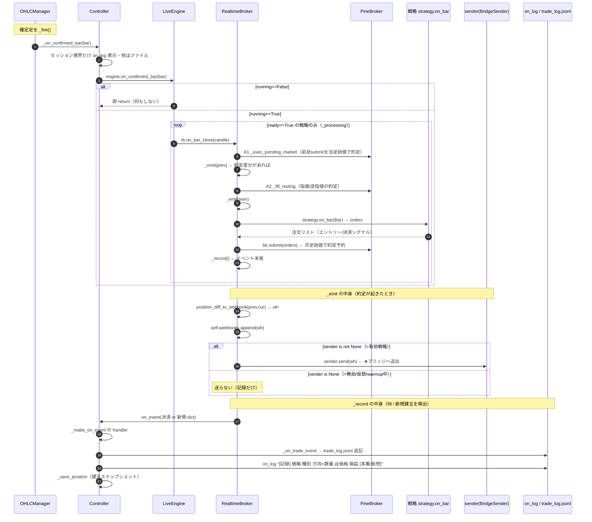
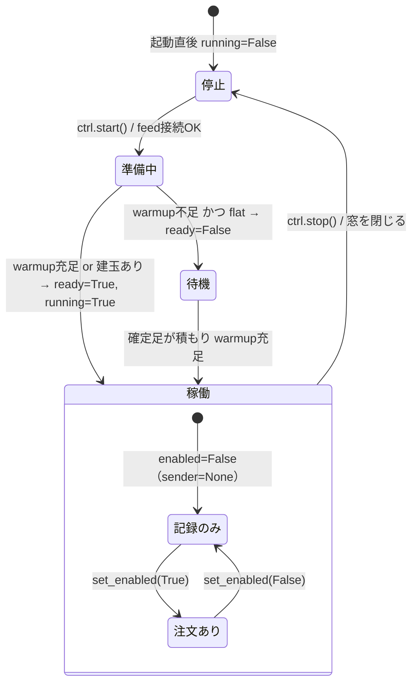
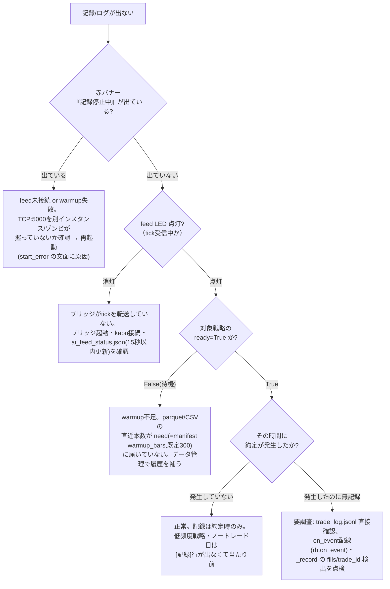

# N225LocalEngine ランタイム・フロー解説（起動 → ろうそく足 → 売買戦略 → シグナル送出 → 記録）

> 作成日: 2026-06-29
> 対象: `N225LocalEngine`（ローカル版エンジン・ライブ運用経路）
> 目的: 起動からトレード記録までの **実行順序・スレッド・非同期処理** を可視化し、「トレード記録／ログがほとんど出ない」原因を切り分けられるようにする。
> 図は **Mermaid**（VSCode / GitHub でそのまま描画。Java・Graphviz 不要）。
>
> ※ ファイル:行番号は 2026-06-29 時点のコード。
>
> **★2026-07-02 改訂**：エンジン fan-out・注文送出のスレッドモデルが変わった。
> ①tick/確定足は受信系スレッドが**キューに積むだけ**になり、fan-out（全戦略評価）は専用ワーカー
> **le-dispatch** が直列実行 ②webhook 送出は共有キュー＋**bridge-send** ワーカー（FIFO・順序保存）
> ③稼働中の登録/パラメータ変更は**差分リロード**（対象戦略のみ背景再構築・他戦略無停止）。
> 詳細＝『スレッド並行性アーキテクチャ報告書』（同フォルダ・07-02 全面改訂版）。

---

## 0. 結論（先に要点）

- ライブ処理は GUI とは **別スレッド**で回る。受信は **TCP受信スレッド**（ブリッジ→tick）と **確定タイマースレッド**（壁時計フォールバック）。**評価（fan-out）は 07-02 から専用ワーカー le-dispatch**（受信系は積むだけ）、**送信は bridge-send ワーカー**。
- 記録（trade_log.jsonl ＋ ログ表示）は **実際に約定（建玉変化）が起きたときだけ** 出る。シグナル送出（webhook）と記録は **同じ約定から別々に生成**され、`_emit`（webhook）が先・`_record`（記録）が後。
- **通常の確定足は GUI ログに出さない設計**（ファイル `data/logs` にのみ残す）。GUI に出るのは **セッション境界足**と **`[記録]`（約定時）** だけ。だから「ログが静か」は異常とは限らない。
- 「記録が出ない」には **4つのゲート**がある（§6）。どれか1つでも閉じていると記録ゼロになる：
  1. `engine.running == True`（feed 起動＋warmup 成功）
  2. broker が `ready == True`（warmup 充足 or 建玉あり）
  3. tick が実際に届いている（ブリッジ接続）
  4. そもそも約定が発生している（低頻度戦略なら出なくて正常）

---

## 1. プロセス／スレッド構成

**ポイント**
- GUI（MAIN）は描画と操作だけ。**トレード判定は MAIN では動かない**。
- **★07-02 改訂**：`engine`（戦略 fan-out）は受信系スレッドで同期実行**されなくなった**。
  - tick／確定足とも受信系スレッド（TCP受信・確定タイマー）は **`engine` のキューに積むだけ**（実測 tick 0.005ms・確定足 1ms）。
  - fan-out（全戦略の on_tick / on_bar_close）は **le-dispatch ワーカーが単一キューから到着順に直列実行**＝2系統スレッドが同じブローカーへ同時侵入する旧競合窓も解消。
  - webhook 送出は **bridge-send ワーカー**（共有 FIFO キュー）＝ブリッジが遅くても受信・評価は止まらない。
- スレッド間の共有状態（`OHLCManager`）は `threading.Lock`（ohlc_processor.py:72）で保護。

---

## 2. 起動シーケンス

**コードポインタ**
| 段階 | 場所 |
|---|---|
| 自動起動スレッド生成 | [dashboard.py:394-411](../../app/dashboard/dashboard.py#L394) |
| feed コールバック配線（動的バインド） | [controller.py:673-674](../../app/engine/controller.py#L673) |
| feed.start()／ポート使用中の中止 | [live_feed.py:54-78](../../app/feed/live_feed.py#L54) |
| warmup 再構築・ready 判定 | [controller.py:625-648](../../app/engine/controller.py#L625) |
| running=True・成功ログ | [controller.py:693-699](../../app/engine/controller.py#L693) |

> ⚠ **2026-06-23 の事故対策**: feed 起動後の warmup が失敗すると「足は流れるのに記録ゼロ」になる。これを防ぐため start() は warmup 以降を try で包み、失敗時は feed を止め `start_error` を**赤バナー＋永続ログ**に必ず出す（[controller.py:690-714](../../app/engine/controller.py#L690)）。

---

## 3. ろうそく足の生成（tick → 確定足）

ブリッジが `:5000` に送る JSON 1行 = 1 tick。`OHLCManager.update_ohlc()` が 15分足を組み立て、**確定**は2経路ある。

**確定の2経路（重要）**
- **データ時刻ロール（通常）**: tick の価格時刻が現バー終端を越えた瞬間に確定（壁時計を待たない＝TV忠実）。[ohlc_processor.py:189-192](../../app/feed/ohlc_processor.py#L189)
- **壁時計フォールバック**: tick が来ない静かな窓・引けは、`bar_end + 猶予秒`で確定タイマーが締める。[ohlc_processor.py:123-142](../../app/feed/ohlc_processor.py#L123)
- セッション末（15:45 / 6:00）は **板寄せ特別足**を実引け値で立てる。[ohlc_processor.py:258-273](../../app/feed/ohlc_processor.py#L258)

> 📌 **ログが静かに見える理由①**: 確定足・ダミー足・板寄せ足は `persist(...)` で **ファイル `data/logs` にのみ記録**し、GUI には出さない（[ohlc_processor.py:236,248,272](../../app/feed/ohlc_processor.py#L236)）。GUI に出る確定足は **controller がセッション境界だけ**表示する（[controller.py:655-668](../../app/engine/controller.py#L655)）。

---

## 4. 売買戦略 → エントリーシグナル → 送出 → 記録（核心）

確定足／tick が `LiveEngine` を通って各 `RealtimeBroker` に配られ、戦略判断・約定・webhook・記録が起きる。

**「シグナル」と「記録」は別物**
- **シグナル送出（webhook）** = `_emit()`。約定差分を `position_diff_to_webhook` で webhook 化し、`sender` があれば送る。[realtime_broker.py:55-64](../../app/engine/realtime_broker.py#L55)
- **記録** = `_record()`。`bk.fills` 増分＝決済、`trade_id` 増加＝新規建玉を検出して `on_event` 通知。[realtime_broker.py:66-91](../../app/engine/realtime_broker.py#L66)
- 同じ約定から両方が出るが、**1イベント内では `_emit`（送出）が先・`_record`（記録）が後**。
- **記録は enabled と無関係に常時**（`sender=None` でも記録は出る）。本番/仮想の区別は記録時に付く。[controller.py:168-194](../../app/engine/controller.py#L168)

**tick 経路（イントラバー約定）も同じ構造**
形成中足の各 tick で `on_tick` が成行（新バー初値）・指値/逆指値のイントラバー約定を検知し、同様に `_emit` → `_record` する。[realtime_broker.py:94-120](../../app/engine/realtime_broker.py#L94)

---

## 5. 状態遷移（running × enabled × ready）

戦略が「記録する／注文する」かは3つのフラグで決まる。

| フラグ | 意味 | 効果 | 設定箇所 |
|---|---|---|---|
| `running` | 自動運用全体 | False なら `on_confirmed_bar`/`on_tick` が即 return（**完全沈黙**） | [engine.py:44,53](../../app/engine/engine.py#L44) |
| `ready` | warmup 充足 | False の戦略は `_processing()` から除外（**評価されない**） | [engine.py:40](../../app/engine/engine.py#L40) |
| `enabled` | 戦略ごと注文可否 | False は `sender=None`＝**記録するが送らない（仮想）** | [controller.py:566-575](../../app/engine/controller.py#L566) |

---

## 6. 「トレード記録／ログが出ない」診断フロー

実際に約定が起きても記録ゼロになるのは、以下のどれかのゲートが閉じているとき。上から順に確認する。

**確認に使う材料**
- `engine_state.json`（`running` / `recording` / `start_error` / `feed` / 各戦略 `ready`・`enabled`）— [controller.py:737-756](../../app/engine/controller.py#L737)
- `ai_feed_status.json`（`bridge_connected` ＋ `updated` が15秒以内）— [live_feed.py:32-42](../../app/feed/live_feed.py#L32) / 判定 [controller.py:593-605](../../app/engine/controller.py#L593)
- `data/logs`（確定足・ダミー足・板寄せ足の `persist` 全件。GUIに出ない足はここ）
- `app/state/trade_log.jsonl`（記録の実体）

> 📌 **よくある誤解**: GUI ログが静か＝壊れている、ではない。通常足は設計上 GUI に出さず（§3）、`[記録]` は約定時のみ（§4）。まず **feed LED と赤バナー**で「足が来ていて記録が動いている」かを確認するのが最短。

> ⚠ **登録したのに warmup も記録も出ない戦略がある場合（ロード失敗）**: その戦略は `load_all` の
> `load_strategy` で例外→`読込失敗 <名>: <理由>` をログに出して **`continue`** され、`engine._brokers`
> に入らない（[controller.py:544-549](../../app/engine/controller.py#L544)）。warmup は `_brokers` を
> ループするだけなので（[controller.py:638](../../app/engine/controller.py#L638)）、**その戦略の `[warmup]` 行は出ず、
> `engine_state.json` の戦略リストにも現れない**（赤バナーも出ない＝他戦略は正常稼働）。
> ＝「**登録数 ＞ warmup 行数 ＝ engine_state の戦略数**」なら、まず `data/logs` の `読込失敗` を確認する。
> 実例（2026-06-30）：MESA5_Portfolio の `config.json` の `session` が repr 文字列に化けて
> `'str' object has no attribute 'get'` でロード失敗（GUI param_form の dict 文字列化バグ・devlog 参照）。

---

## 7. スレッド安全性のまとめ

| 共有資源 | 書き手スレッド | 読み手 | 保護 |
|---|---|---|---|
| `OHLCManager`（形成中足・bar境界） | TCP受信／確定タイマー | 同左 | `threading.Lock`（ohlc_processor.py:72） |
| parquet（確定足） | feed／データ管理(⑥) | BT(⑤)／GUI | OHLCStorage の lock |
| `engine`（戦略 fan-out） | feed（同期呼出） | poll／GUI | 動的参照＋GIL（lock不要設計） |
| `trade_log.jsonl` | feed（約定時 append） | GUI(⑦ read) | **ロックなし**（低確率の途中読みリスク） |
| `rb.sender` | GUI(set_enabled) | feed | capture してから None 判定（realtime_broker.py:62-64） |

- ライブの戦略評価は **fan-out 元スレッドで同期実行**（engine.py の `_processing` ループ）。戦略は順次処理なので broker 間の競合は無い。
- `feed.mgr.on_tick = self._engine_on_tick` は **動的バインド**。`load_all()` で engine を作り直しても feed は最新 engine を参照するため、登録/パラメータ変更が**再起動なしで反映**される（[controller.py:674](../../app/engine/controller.py#L674)）。

---

## 付録: 主要コードポインタ早見表

| 役割 | ファイル:行 |
|---|---|
| tick 受信（TCP） | [live_feed.py:80-161](../../app/feed/live_feed.py#L80) |
| ろうそく足生成・確定 | [ohlc_processor.py:144-225](../../app/feed/ohlc_processor.py#L144) |
| 壁時計フォールバック確定 | [ohlc_processor.py:113-142](../../app/feed/ohlc_processor.py#L113) |
| confirmed bar 受け（表示判定） | [controller.py:655-672](../../app/engine/controller.py#L655) |
| engine fan-out（running/ready ゲート） | [engine.py:37-59](../../app/engine/engine.py#L37) |
| 戦略判断 on_bar_close | [realtime_broker.py:123-155](../../app/engine/realtime_broker.py#L123) |
| webhook 作成・送出 _emit | [realtime_broker.py:55-64](../../app/engine/realtime_broker.py#L55) |
| 記録通知 _record | [realtime_broker.py:66-91](../../app/engine/realtime_broker.py#L66) |
| trade_log 追記・ログ表示 | [controller.py:173-194](../../app/engine/controller.py#L173) |
| 起動 start／失敗時 start_error | [controller.py:650-714](../../app/engine/controller.py#L650) |
| 状態 status／engine_state.json | [controller.py:737-756](../../app/engine/controller.py#L737) |
