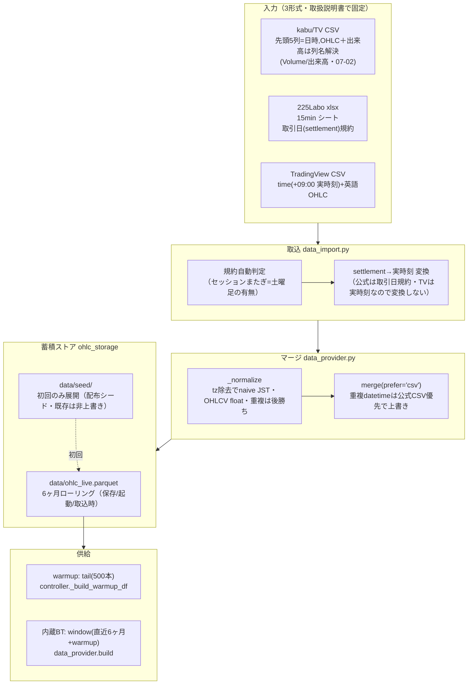
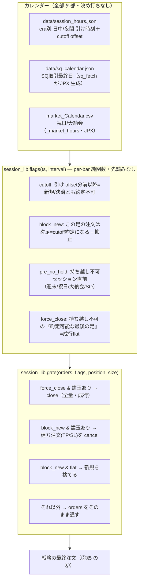
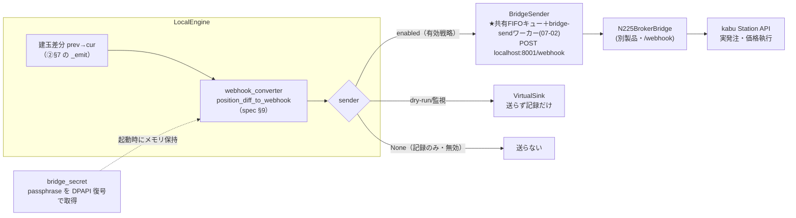

# N225LocalEngine 解説③：周辺サブシステム（データ・カレンダー/セッション・ブリッジ境界・状態永続化）

> 作成日: 2026-06-30　**改訂: 2026-07-02**（送信キュー化・CSV出来高の列名解決を反映）
> 対象: `N225LocalEngine`（ローカル版）
> 目的: 既存2文書が扱わない**「戦略と約定を支える周辺」**を一気通貫で図解する。
> 既存：[`①ランタイムフロー解説`](N225LocalEngine_ランタイムフロー解説.md)（起動→足→送出→記録）／
> [`②Python戦略とエンジンの関係解説`](N225LocalEngine_Python戦略とエンジンの関係解説.md)（契約・約定・ロジック）。
> 本書（③）が埋める穴＝**A. データ管理／B. カレンダー・セッション・SQ／C. ブリッジ境界／D. 状態の永続化マップ**。
>
> 図は **Mermaid**。※ ファイル:行番号は 2026-06-30 時点のコード。

---

## 0. 結論（先に要点）

- **データ管理（A）**：履歴は **3形式**（kabu CSV／225Labo xlsx／TradingView CSV）を取り込み、**内部標準＝実時刻**に正規化、**蓄積 parquet にマージ → 6ヶ月ローリング**で保つ。重複バーは **公式 CSV 優先で上書き**（tick 集計足を公式精度へ補正）。
- **カレンダー/セッション（B）**：**「いつ売買してよいか」だけ**を別レイヤ（`session_lib`）が per-bar・**先読みなし**で判定。時刻・SQ・祝日は**すべて外部 JSON/CSV**（決め打ちなし＝時代変更に追従）。Pine の KengetsuLib と同一カレンダー＝**Pine BT≡Python BT≡ライブ**が一致。
- **ブリッジ境界（C）**：エンジンは**自分で発注しない**。建玉差分を webhook（spec §9）に変換し、**ブリッジ（別製品）へ POST するだけ**。実際の kabu 発注・価格執行はブリッジの責務。passphrase は**ブリッジから DPAPI 復号で取得**（ローカルに保存しない）。
- **状態の永続化（D）**：再起動で失わない情報は **`app/state/` と `data/`** に集約。`engine_state.json`（赤バナー/LED の素）・`trade_log.jsonl`（記録の実体）・`positions/`（建玉スナップ）・`ohlc_live.parquet`（ライブ足）など、**ファイル＝唯一の真実**。

---

## A. データ管理サブシステム（履歴 OHLC の入手 → 蓄積 → 供給）

戦略の warmup と内蔵BT は「直近の 15 分足履歴」を必要とする。その供給ラインがこれ。

**要点（決め打ちしない・[[feedback_no_hardcoding]]）**
- **タイムスタンプ規約**：日本の先物提供元（kabu/225Labo/JPX）は**取引日(settlement)規約**で配信（夜間＝翌営業日の日付）。取込時に**実時刻へ変換**して内部標準に統一（[data_import.py:1-20](../../app/backtest/data_import.py#L1)）。規約は**土曜足の有無で自動判定**。
- **TV CSV は実時刻**（先頭列 `time`・+09:00）なので **settlement 変換しない**。`_normalize` が +09:00 を naive JST に揃える（値は不変）（[data_provider.py:18-34](../../app/backtest/data_provider.py#L18)）。
- **マージは「公式 CSV 優先」**：蓄積（tick 集計の近似足）と公式 CSV が重複したら **CSV で上書き**＝蓄積足を公式精度へ補正（[data_provider.py:61-73](../../app/backtest/data_provider.py#L61)）。
- **★CSV 取込の出来高（07-02）**：TV エクスポートは「出来高」インジをチャートに載せた時だけ Volume 列が付き、位置は指標列の後ろで不定。`data_provider.load_csv` は**列名（Volume/出来高・大小無視）で出来高を解決**し、指標列が挟まっても誤読しない。OHLC を名前で判別できる CSV に出来高列が無い場合は 0 埋め（指標値の誤読防止）。**運用＝15分タブに「出来高」を載せたままにする**。
- **6ヶ月ローリング**：蓄積は無限に増やさず直近6ヶ月（`MONTHS_KEEP=6`）。BT も「直近6ヶ月＋warmup」を `window()` で切り出す（[data_provider.py:76-84](../../app/backtest/data_provider.py#L76)）。
- **保存先は自己完結**（共有フォルダを撤去）：ライブ足＝`data/ohlc_live.parquet`（warmup/BT と**同一ファイル**）。配布版は初回だけ `data/seed/` を展開（[[reference_localengine_candle_store]]）。

> 📌 この parquet は **ランタイムフロー解説 §3 の確定足**が `persist`/保存する先と同一。「足を作る（feed）」と「足を供給する（data_provider）」が**同じストアを共有**している。

---

## B. カレンダー・セッション・SQ（「いつ売買してよいか」レイヤ）

戦略ロジック（②§5）は「**何を**したいか」を決める。**「今**約定してよいか**」は別レイヤ** `session_lib` が判定し、戦略の最終注文を間引く。Pine の KengetsuLib に対応する Python 単一ソース。

**要点**
- **era 対応**：日中引け 15:15→15:45、夜間 16:30→17:00 のような**歴史的な時刻変更**を `session_hours.json` の `regimes`（`from` 日付つき）で表現。日付に応じて有効 regime を選ぶ（[session_lib.py:119-130](../../app/feed/session_lib.py#L119)）。＝**長期データでも時代に追従**して壊れない。
- **cutoff/offset も外部化**：既定 30 分前（`DEFAULT_OFFSET_MIN`）だが interval ごとに `offset_min_by_interval` で上書き可（[session_lib.py:133-136](../../app/feed/session_lib.py#L133)）。
- **持ち越し不可の判定**：夜間足は「翌朝引け先が休場か」、日中足は「夜間がない大納会／SQ取引最終日／翌日が休場」を見て **force_close**（[session_lib.py:194-202](../../app/feed/session_lib.py#L194)）。3連休前に金曜夜間がデータ欠でも週末跨ぎを確実に防ぐ。
- **入力 ts の頑健化**：offline は `pd.Timestamp`、warmup/一部 live は `numpy.datetime64` を渡す。これを `_to_dt` が吸収しないとナノ秒9桁で `fromisoformat` が静かに失敗→gating 無効になる。ここを揃えることが **BT≡live≡warmup の一致条件**（[session_lib.py:96-116](../../app/feed/session_lib.py#L96)）。
- **素コピーでも動く**：`_market_hours` 未導入なら**週末のみ**にフォールバック（配布の最小形でも安全側）。
- **ポートフォリオは1回だけ gate**：MESA5_Portfolio は**合成後の最終注文**を1回 gate し、サブ側 gate は無効化（二重化回避・②と整合）。

> 📌 `flags()` は **ts とカレンダーだけで決まる純関数**。だから同じ足なら BT でもライブでも同じ判定＝Pine と同一シーケンス。

---

## C. ブリッジ境界（webhook → kabu 発注）

エンジンは**自分で証券会社に発注しない**。建玉が変化したら webhook に変換し、ブリッジ（別製品・TV ブローカー役）へ渡すだけ。価格執行・建玉整合はブリッジの責務（D7）。

**要点**
- **差分の分類**（[webhook_converter.py:13-50](../../app/engine/webhook_converter.py#L13)）：prev→cur のポジション遷移を **新規／全量返済／部分返済(3Split)／ドテン** に分け、`order_action`(buy/sell)・`order_contracts`・market_position 等を載せる。`order_price=0`＝成行（ブリッジが対等価格執行）。
- **3つの sender**（[bridge_sender.py](../../app/engine/bridge_sender.py)）：
  - `BridgeSender` … 有効戦略。**★07-02 キュー化**：`send()` は共有 FIFO キューに積んで即返り、専用ワーカー `bridge-send` が `POST :8001/webhook`（timeout 5秒）を実行。**ブリッジが遅くても feed/評価は止まらず、全戦略の送信順序は保存**。終了時は `flush()` で未送出を掃き出し。
  - `VirtualSink` … 送らず webhook を記録（仮想 P&L は `bk.fills` から）。
  - `None` … 記録のみ（無効戦略）。**記録は常時・全戦略**、送出は enabled のみ（①②と一貫）。
- **passphrase はブリッジ正**（[bridge_secret.py](../../app/engine/bridge_secret.py)）：webhook 両端で一致必須の共有値なので、ブリッジの `%LOCALAPPDATA%\N225BrokerBridge\appsettings.Local.json`（DPAPI `enc:`）を**起動時に復号取得**してメモリ保持。**ローカルにファイル保存しない**。取得不可（未導入/別ユーザー）なら `""`。
- **ブリッジ制御**（`BridgeProcess`）：ダッシュボードからブリッジ起動/停止。`is_up`（ポート判定・手動起動も検知）・`started_by_dashboard`（停止可否）・`kabu_ok`（カブステーション稼働）を `poll_external` が3秒毎に実測（①§1 のポーラー）。
- ※ ブリッジ本体は**別製品で無断変更しない**（[[feedback_no_bridge_changes_without_confirmation]]）。ローカルは webhook を出すところまで。

---

## D. 状態の永続化マップ（再起動で失わないもの＝ファイルが真実）

「いま何が起きているか」「何を持っているか」は**すべてファイル**に出す。GUI もブリッジ連携も**ファイル経由**で疎結合（①§7 のスレッド安全表と対応）。

```mermaid
flowchart TB
    subgraph STATE["app/state/（制御・記録）"]
        ES["engine_state.json<br/>running/recording/start_error/<br/>kabu/bridge/feed/各戦略 ready・enabled"]
        REG["registered.json<br/>登録戦略（folder/alert_name/interval/enabled）"]
        SET["settings.json<br/>テーマ/文字サイズ/bridge_url/データパス等"]
        TL["trade_log.jsonl<br/>新規/決済イベント累積（記録の実体）"]
        POS["positions/&lt;name&gt;.json<br/>建玉スナップショット（確定足ごと）"]
        FS["ai_feed_status.json<br/>bridge_connected＋updated（15秒鮮度）"]
    end
    subgraph DATA["data/（市場データ・カレンダー・ログ）"]
        PQ["ohlc_live.parquet（ライブ足・6ヶ月）"]
        LOGS["logs/localengine_YYYY-MM-DD.log（足/記録 全件）"]
        CALS["session_hours.json / sq_calendar.json / market_Calendar.csv"]
        HIST["history/trade_archive_YYYY-Qn.csv（6ヶ月超を退避）"]
    end

    CTRL["controller"] -->|_write_state| ES
    CTRL -->|register/load_all| REG
    CTRL -->|_on_trade_event| TL
    CTRL -->|_save_all_positions| POS
    FEED["live_feed"] -->|状態書込| FS
    FEED -->|確定足保存| PQ
```

| ファイル | 役割 | 読み手 | 書き手 |
|---|---|---|---|
| `engine_state.json` | 稼働状態・**赤バナー/LED の素**・各戦略 ready/enabled | ダッシュボード | controller `_write_state`（[controller.py:749-766](../../app/engine/controller.py#L749)） |
| `registered.json` | 登録戦略リスト（ID=フォルダ名） | controller `load_all` | register/unregister |
| `trade_log.jsonl` | 新規/決済の**記録の実体**（仮想/本番とも） | 取引記録ビュー | `_on_trade_event`（②§7） |
| `positions/<name>.json` | 建玉＋出口状態のスナップ（受動記録） | （warmup_replay が主・参考） | 確定足ごと `_save_all_positions` |
| `ai_feed_status.json` | tick 受信中か（bridge_connected＋15秒鮮度） | controller `_read_feed_connected` | live_feed |
| `ohlc_live.parquet` | ライブ確定足（warmup/BT と共有・6ヶ月） | data_provider / feed | OHLCStorage |
| `data/logs/*.log` | 足・ダミー足・板寄せ・`[記録]` 全件 | 人間（診断） | feed.logger.persist |

**要点**
- **建玉の復元は warmup_replay が主**（②§4）。`positions/` は受動スナップ（参考・監査）で、再起動の建玉整合は**履歴再生で作る**のが現行設計（snapshot/restore は補助）。
- **start_error を必ず可視化**：feed 未接続/warmup 失敗は `engine_state.json` と永続ログに残し赤バナー表示（①§2 の 2026-06-23 対策）。
- **データパスは設定可**：`settings.json` の `parquet_path`/`csv_dir` で差し替え可（既定＝製品ツリーの `data/`）（[controller.py:108-111](../../app/engine/controller.py#L108)）。

---

## 付録: 周辺サブシステム コードポインタ早見表

| 役割 | ファイル:行 |
|---|---|
| データ取込（3形式・規約自動判定・settlement変換） | [data_import.py](../../app/backtest/data_import.py) |
| 正規化・マージ・6ヶ月窓・BT供給 | [data_provider.py](../../app/backtest/data_provider.py) |
| ライブ足ストア・seed展開 | [ohlc_storage.py](../../app/feed/ohlc_storage.py) |
| セッション可否（flags/gate・era・SQ） | [session_lib.py](../../app/feed/session_lib.py) |
| 市場時間・祝日・大納会（単一ソース） | [_market_hours.py](../../app/feed/_market_hours.py) |
| 建玉差分→webhook（spec §9） | [webhook_converter.py](../../app/engine/webhook_converter.py) |
| webhook 送出（本番/仮想/記録のみ） | [bridge_sender.py](../../app/engine/bridge_sender.py) |
| passphrase 取得（DPAPI 復号） | [bridge_secret.py](../../app/engine/bridge_secret.py) |
| 外部ブリッジ制御（起動/停止/実測） | [bridge_process.py](../../app/engine/bridge_process.py) |
| 状態書込・データパス・sender生成 | [controller.py:78-122](../../app/engine/controller.py#L78) / [749-766](../../app/engine/controller.py#L749) |

---

## まとめ：3部作の地図

| 文書 | カバー範囲 |
|---|---|
| ①ランタイムフロー | 起動シーケンス・スレッド・ろうそく足の確定・送出/記録・**診断フロー** |
| ②戦略⇄エンジン | 契約（注文/globals）・3フェーズ約定・二刀エンジン・戦略5段ロジック・3Split |
| **③周辺（本書）** | **データ管理・カレンダー/セッション/SQ・ブリッジ境界・状態永続化** |

3本で「データが入り → 足になり → 戦略が判断し → エンジンが約定し → ブリッジへ出し → 記録に残る」全工程が追える。
