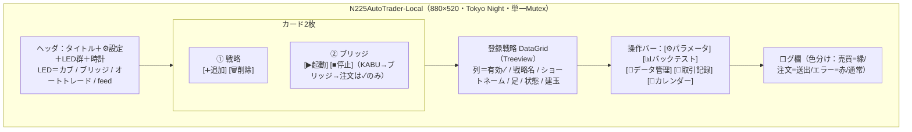
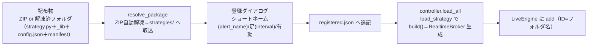
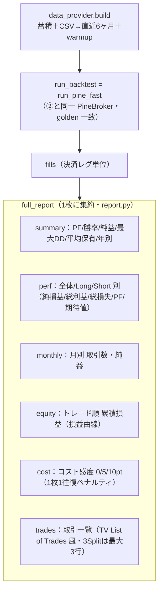
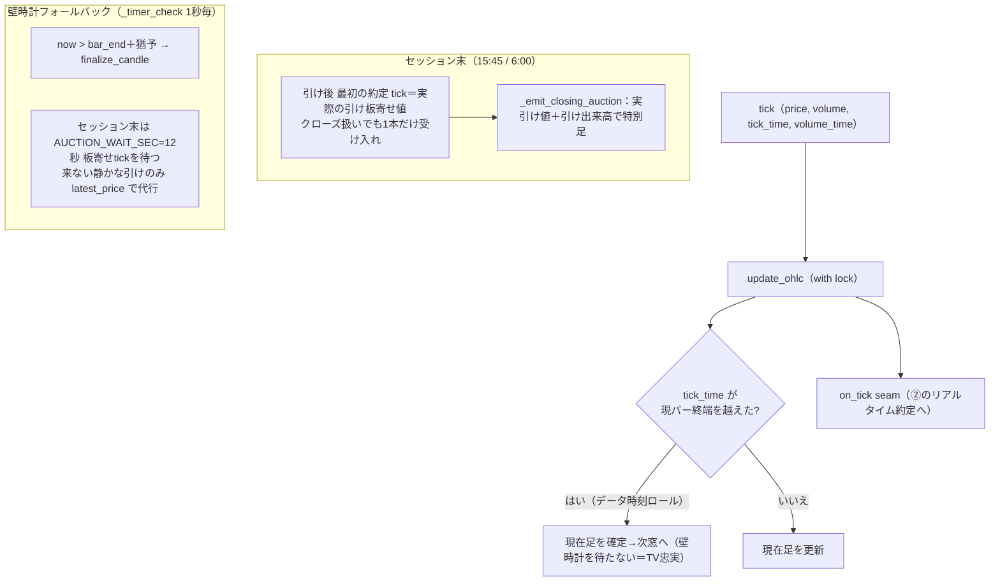
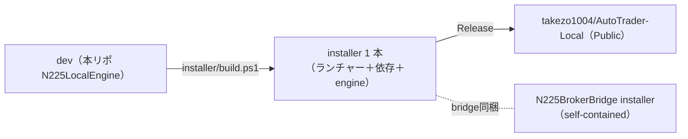

# N225LocalEngine 解説④：運用・ダッシュボード・内蔵BT・調整・ろうそく足深部・配布

> 作成日: 2026-06-30　**改訂: 2026-07-02**（差分リロード・非同期化＝GUIフリーズ解消を反映）
> 対象: `N225LocalEngine`（ローカル版）
> 目的: 既存3文書（裏側の実行基盤）に対し、**運用者が触る表側**を完結させる。
> シリーズ：[`①ランタイムフロー`](N225LocalEngine_ランタイムフロー解説.md)／[`②戦略⇄エンジン`](N225LocalEngine_Python戦略とエンジンの関係解説.md)／[`③周辺サブシステム`](N225LocalEngine_周辺サブシステム解説.md)／**④本書（運用・GUI）**。
> 本書が埋める穴＝**A. ダッシュボード画面／B. 戦略登録・パッケージ／C. 内蔵BT・調整・再最適化／D. ろうそく足の深部アルゴリズム／E. カレンダー・SQ 運用／F. 配布・アップデート／G. テスト**。
>
> ※ GUI の「操作手順」は `LocalEngine/docs/USER_MANUAL.md`、配布の正本は ルート `DISTRIBUTION_MAP.md`。本書は**アーキテクチャ視点**でそれらを束ねる。
> 図は **Mermaid**。※ ファイル:行番号は 2026-06-30 時点のコード。

---

## 0. 結論（先に要点）

- **ダッシュボードが唯一の司令塔**（独立1枚・[dashboard.py](../../app/dashboard/dashboard.py)）。運用は **①戦略登録 → ②カブステーション確認 → ③ブリッジ起動** の3手。**自動運用は起動と同時**（feed 待受＝記録開始）。起動/停止ボタンは無い（停止＝戦略の✓を外す／ブリッジ停止／窓を閉じる）。
- **記録は全戦略・常時／注文は戦略ごとの「有効✓」のみ**（②③と一貫）。**オートLED は「running かつ 有効戦略≥1」で点灯＝実弾が出る合図**。
- **戦略は ZIP/フォルダで配布・登録**。エンジンは戦略の中身を知らない＝**新戦略を足してもエンジン無改修**（登録・パラメータ・BT・再最適化すべて汎用）。
- **内蔵BT は run_pine_fast で半年窓を回す**＝②の正本約定と同一。成績（PF/DD/月別/損益曲線/コスト感度/取引一覧）を1枚で出す。**パラメータ調整はBTを開いたまま反復**、**再最適化は戦略同梱 optimize.py を呼ぶだけ**。
- **ろうそく足生成は最も繊細な無傷資産（D13）**。確定2経路（データ時刻ロール／壁時計）＋**板寄せ特別足**（実引け値・12秒待ち）＋**価格と出来高の時刻分離**＋セッション境界クランプ。**時刻は決め打ちせず単一ソース**から。
- **配布は 3 区分＋シミュレーター**（①本家ブリッジ ②開発キット ③ローカル版 ＋ シミュレーター版。正本＝ルート `DISTRIBUTION_MAP.md`）。ローカル版は **installer 1 本**で自己完結。アップデートは**コード入替・ユーザーデータ絶対保持**。

---

## A. ダッシュボード画面構成（司令塔）



**LED の意味**（[dashboard.py:96](../../app/dashboard/dashboard.py#L96)・運用モデルの要）

| LED | 点灯条件 | 意味 |
|---|---|---|
| **カブ** | カブステーション稼働 | 発注の大元（kabu API）が生きている |
| **ブリッジ** | ブリッジ稼働（手動起動含む） | webhook 受け口が立っている |
| **オートトレード** | **running かつ 有効戦略≥1** | **緑＝実弾が出る状態**（記録のみの戦略しかなければ消灯） |
| **feed** | tick 受信中（ai_feed_status 15秒鮮度） | ブリッジ→tick が実際に届いている |

**運用フロー**（[dashboard.py:7-13](../../app/dashboard/dashboard.py#L7)）
1. **①戦略を登録**（ZIP/フォルダ）→ 一覧に出る。
2. **②カブ確認 → ③ブリッジ起動**。
3. 自動運用は**起動と同時**（`_auto_start`＝ウィンドウ先表示 → warmup を背景スレッド → `ctrl.start`）。warmup 完了まで `running=False` で発注しない（[dashboard.py:394-411](../../app/dashboard/dashboard.py#L394)）。
4. 注文を出したい戦略だけ一覧の**有効✓**を入れる（記録は✓に関係なく常時）。
5. 停止＝✓を外す／ブリッジ停止／窓を閉じる。

> 起動の遅さ（warmup）は**ウィンドウ先表示＋背景 warmup＋300本短縮**で体感を改善（28→11秒）。

---

## B. 戦略登録・パッケージング（エンジンは中身を知らない）



**要点**
- **2段階登録**：①配布 ZIP/フォルダを取込（自動解凍）→ ②ショートネーム（ブリッジ alert_name）・足・有効を指定（[dashboard.py:227-265](../../app/dashboard/dashboard.py#L227)）。
- **ID＝フォルダ名**。webhook はショートネーム＋足＋共通 passphrase で送る（③C と整合）。
- **manifest.json**（`name/interval/warmup_bars/version`）が無ければ `module.MANIFEST` を使う（②のローダ）。
- **稼働中に登録/変更しても再起動不要（★07-02 差分リロードに刷新）**：登録追加・登録編集・パラメータ保存は `controller.reload_one(name)`＝**対象戦略だけ**を背景スレッドで再読込→warmup→原子的差替。**他戦略と engine.running は無停止・GUI は固まらない**（旧＝全戦略再warmup 42秒が GUI スレッドで走り「応答なし」になっていた）。ログは「差分リロード：バックグラウンドで warmup 中…」→「差分リロード完了（他戦略は無停止）」。全体 `load_all` の再有効化も背景化済（feed コールバックは engine を動的参照）。
- 配布 ZIP 作成は Builder 側ツール `distribution/package_strategy.py`（`_subs`＋manifest 自動生成）。

> ⚠ 登録したのに warmup も出ない戦略がある時は **ロード失敗**（`読込失敗 <名>`）。①の診断フロー補注を参照（2026-06-30 の MESA5_Portfolio 事例）。

---

## C. 内蔵BT・パラメータ調整・再最適化

### C-1. 内蔵BT（full_report）— ②の正本約定で半年を回す



- **正本BT＝run_pine_fast**（[report.py:17-21](../../app/backtest/report.py#L17)）。ライブと同じ約定器なので **BT成績＝ライブ挙動**（②§4）。
- **BTビュー**は窓を閉じずに再実行＝その場更新（[dashboard.py:310-320](../../app/dashboard/dashboard.py#L310)）。6ヶ月未満でも実行（忠告のみ）。
- 成績の正式値は**Python 4年較正BT**が基準（TV は約6ヶ月で楽観的・[[feedback_python_4y_is_authoritative]]）。

### C-2. パラメータ調整ループ（param_form）

- `config.json` を GUI で編集（数値=Entry／列挙=Combobox／真偽=Checkbutton／phase別=6×4表）。**list/dict は読み取り専用・保存時保持**（2026-06-30 修正でネスト dict も壊さない）。
- **[保存してバックテスト]で窓を開いたまま調整→BT を反復**（[param_form.py:229-249](../../app/dashboard/param_form.py#L229)）。
- `_subs/` があればサブ別 config もタブ表示（合成戦略・MESA5_Portfolio）。
- ★config の**値**はユーザーが BT で現市場に調整する前提＝Pine 既定と違って当然（[[feedback_config_params_intentionally_tuned]]）。

### C-3. 再最適化（reopt）— エンジン無改修の汎用フック

```mermaid
sequenceDiagram
    participant UI as [🔄 再最適化]
    participant RE as reopt（汎用）
    participant OPT as 戦略同梱 optimize.py
    UI->>RE: build_ctx（蓄積データ・内蔵BT・pt換算を詰める）
    RE->>OPT: propose(ctx) → {title,window,items[old→new],_payload}
    OPT-->>UI: 提案（差分）を提示
    Note over UI: ユーザー承認（承認制）
    UI->>RE: apply(ctx, proposals)
    RE->>OPT: apply（config 等を書き換え）
```

- **エンジンは戦略中身（tp1R/サブ等）を一切知らない**。戦略パッケージが `optimize.py`（`propose/apply`）を持参していれば `[🔄再最適化]` がそれを呼ぶだけ（[reopt.py:1-13](../../app/engine/reopt.py#L1)）。
- → **新合成戦略を作っても、その戦略が optimize.py を同梱するだけで動く＝再配布・バージョンアップ不要**（2026-06-29 実装の狙い）。
- 窓＝直近1年（`WINDOW_MONTHS=12`・現市場レジーム）。承認制（勝手に書き換えない）。

---

## D. ろうそく足の深部アルゴリズム（D13・最重要の無傷資産）

①§3 はフロー水準。ここは**アルゴリズムの中身**。`ohlc_processor.py` は「一字一句変えない」資産（ユーザーが最も苦労した箇所）。



**核心の4点**
- **確定2経路**：①**データ時刻ロール**（tick の価格時刻が終端越え＝壁時計を待たない・TV 忠実）／②**壁時計フォールバック**（静かな窓・引けは `bar_end＋猶予` でタイマー確定）。
- **板寄せ特別足**（[ohlc_processor.py:144-166,258-272](../../app/feed/ohlc_processor.py#L144)）：引け（15:45/6:00）後に最初に届く約定＝**実際の引け板寄せ約定値**。市場クローズ扱いでも**この1本だけ受け入れ**、実引け値＋引け出来高で特別足を立てる。`AUCTION_WAIT_SEC=12` 秒待ち、来ない静かな引けのみ `latest_price` で代行。`_last_auction_dt` で二重発火防止。
- **価格と出来高の時刻分離**（2026-06-24）：価格(OHLC)は**価格時刻**(`tick_time`)、出来高は**売買高時刻**(`volume_time`)のバーへ。正時境界で始値/終値が隣バーへ誤配置されていた40円ズレの根治。`volume_time` 無し（旧ブリッジ）は `tick_time` 流用＝後方互換。
- **決め打ち撤去**（[[feedback_no_hardcoding]]）：セッション時刻（8:45/15:45/17:00/6:00）は `get_bar_times` に直書きせず**単一ソース `_market_hours`** から。日中15:15→15:45・夜間16:30→17:00 等の制度変更に1箇所で追従。

> このロジックは `_timer_check` が `is_market_open()` **または `_is_session_close(bar_end)`** で確定するため、引けでクローズ扱いでもセッション末足を必ず締める（2026-06-26 の 15:45/6:00 欠落バグ修正）。

---

## E. 市場カレンダー・SQ の取得と更新運用

③B が「使う側」。ここは「**作る・保つ側**」。

| 対象 | 生成元 | 保存 | 更新 UI |
|---|---|---|---|
| 祝日・大納会 | **JPX 祝日取引**（唯一の権威・jpholiday 不採用）`calendar_fetch` | `data/market_Calendar.csv`（複数年マージ） | 設定→[カレンダーを更新] |
| SQ（取引最終日） | `sq_fetch`（JPX 生成） | `data/sq_calendar.json` | 同上 |
| セッション時刻 | 手動/era 定義 | `data/session_hours.json`（regime） | — |

**要点**
- **取得元 URL は settings.json へ外出し**（将来 URL 変更は [📅] ダイアログで手動設定・失敗時は「URL が変わった可能性」を案内）。
- **起動時のみ鮮度判定** → 要更新なら **[📅カレンダー] ボタンが赤＋⚠**、ログも色分け（[dashboard.py:355-368](../../app/dashboard/dashboard.py#L355)）。定期チェックはしない。
- 複数年マージ取得（当年限定で翌年を捨てる旧バグを是正）。CSV スキーマ＝`date,name,status,confirmed,source,fetched_at`（後方互換）。

---

## F. 配布・アップデート（3製品・正本＝DISTRIBUTION_MAP）

> 詳細の正本は ルート `DISTRIBUTION_MAP.md`。ここは要点のみ。



- **3製品＝別製品・コード共有しない**（[[project_localengine_separate_product]]）：①シミュレーション ②TV版 ③ローカル版。ローカル版は**自己完結**・結合は Webhook のみ・戦略コードはバンドル。
- **エンジン基本ルート＝uv（`uv sync`）**。**ブリッジ同梱＝案A**（source＋compiled installer 同梱・Inno AppId 固定で二重インストール防止）。
- **アップデート＝コード入替・ユーザーデータ絶対保持**（`data/`・`app/state/`・`%LOCALAPPDATA%`）。6ヶ月シードは `data/seed/` 初回のみ展開（既存非上書き）。
- ブリッジ修正は **dev commit→3製品 sync→push**（[[feedback_bridge_fix_always_commit]]）。**販売リポへの push は要確認**（外部公開）。

---

## G. テスト・検証（品質の担保）

- **golden 一致**：`tests/test_offline_golden.py`（確定 config のスナップショット）。ZigZag タイ・over/under クロス等の Pine 厳密一致を固定。
- **offline≡realtime**：`test_offline_eq_realtime.py`（②の二刀一致＝指値 intrabar 再現）を pytest 化済（自動回帰）。
- **ろうそく足**：`tests/test_candle.py`（板寄せ実引け値 T13・二重発火なし T14・クローズ中フォールバック等）。
- **TV照合**：`tests/verify_tv_match.py`／`strategies/_engine/verify_tv.py`（TV Strategy Tester と entries/exits 照合・97〜100%一致＝移植忠実）。
- ★**ライブ中はフル pytest を避ける**（test_controller が送出し得る・2026-06-24 教訓）。検証はヘッドレス build か安全帯で。

---

## まとめ：4部作で「ローカルエンジンすべて」

| 文書 | 視点 | カバー範囲 |
|---|---|---|
| ① ランタイムフロー | 実行時の流れ | 起動・スレッド・足確定・送出/記録・診断 |
| ② 戦略⇄エンジン | 売買の中身 | 契約・3フェーズ約定・二刀エンジン・戦略5段・3Split |
| ③ 周辺サブシステム | 支える土台 | データ管理・カレンダー/セッション/SQ・ブリッジ境界・状態永続化 |
| **④ 運用・GUI（本書）** | **使う・調整する** | **ダッシュボード・登録/パッケージ・内蔵BT/調整/再最適化・ろうそく足深部・カレンダー運用・配布・テスト** |

**読む順の目安**
- 全体を掴む → ① → ②。
- 戦略を作る/調整する → ② → ④C。
- データ/カレンダー/ブリッジを直す → ③。
- 運用・配布する → ④ →（詳細は USER_MANUAL / DISTRIBUTION_MAP）。

これで「データが入り → 足になり → 戦略が判断し → エンジンが約定し → ブリッジへ出し → 記録に残り → 人がダッシュボードで運用・調整・配布する」**全工程**が4本で追える。
